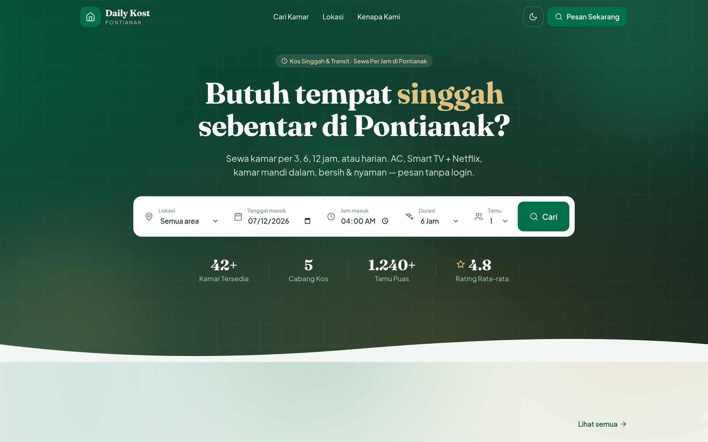
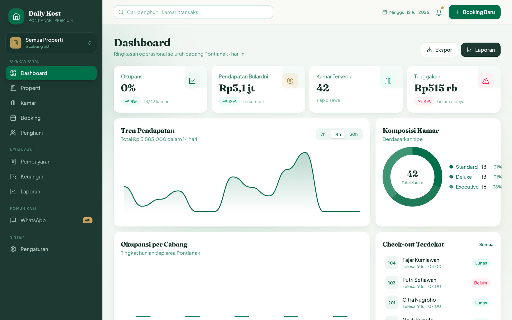
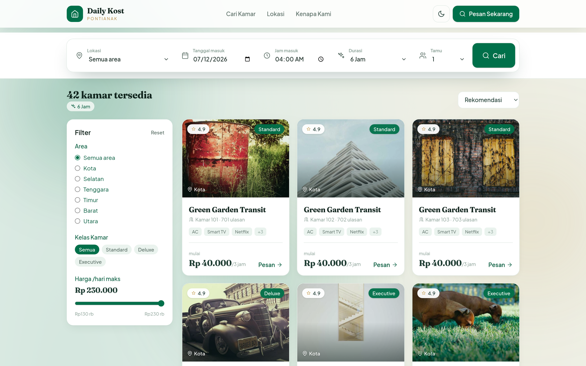
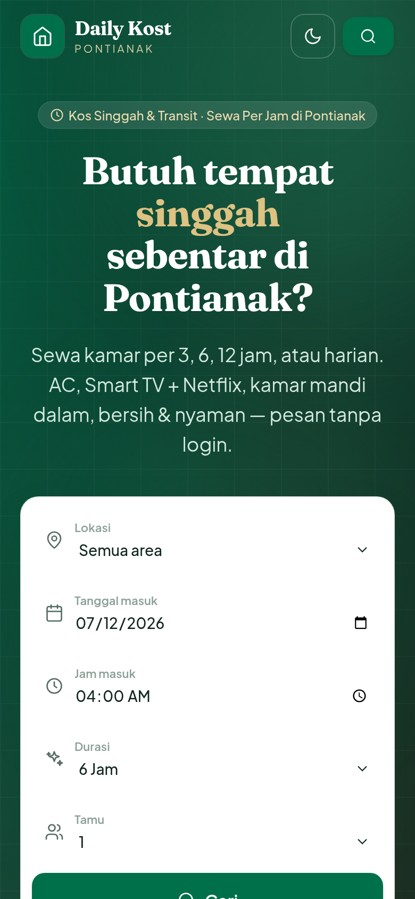
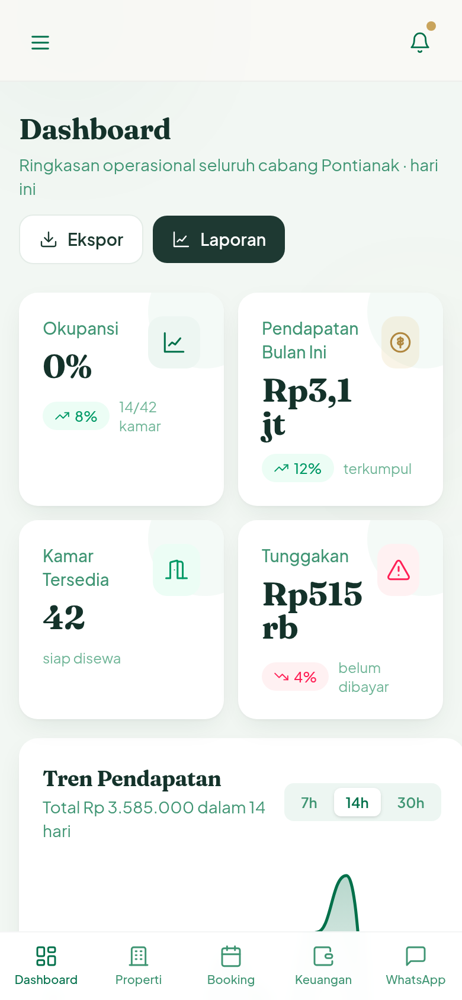

<div align="center">

# 🌿 Daily Kost

### Platform kos singgah & transit — sewa per jam sampai harian

Butuh tempat singgah sebentar? **Daily Kost** menghubungkan tamu dengan kamar kos
transit yang bisa disewa **per 3 / 6 / 12 jam atau harian** — pesan tanpa login,
plus panel pemilik lengkap untuk mengelola seluruh operasional bisnis.

<br />

[](https://kostpontianak.web.id)
&nbsp;
[](https://kostpontianak.web.id/app)

<br />


</div>

<br />

<div align="center">
  
</div>

<br />

## ✨ Sorotan

Satu aplikasi, dua sisi yang saling terhubung:

<table>
<tr>
<td width="50%" valign="top">

### 🧳 Sisi Tamu

- **Sewa fleksibel** — durasi 3, 6, 12 jam, atau harian dengan perhitungan otomatis
- **Pesan tanpa login** — cukup nama & nomor HP, bayar di tempat
- **Cari & filter** — area, kelas kamar, harga maksimal, urutkan rekomendasi
- **Detail kamar** — foto, fasilitas (AC, Smart TV + Netflix, WiFi, kamar mandi dalam), harga per durasi
- **Dark mode** elegan & tampilan mobile-first

</td>
<td width="50%" valign="top">

### 🛠️ Panel Pemilik `/app`

- **Dashboard** — okupansi, pendapatan, tunggakan, tren & komposisi kamar
- **Multi-properti** — kelola beberapa cabang dari satu tempat
- **Kamar & Booking** — CRUD, status, check-in/out, riwayat
- **Penghuni** — profil, riwayat menginap, quick WhatsApp
- **Keuangan** — pembayaran, laba/rugi, pengeluaran, laporan & ekspor
- **WhatsApp Center** — broadcast & pesan personal ber-template

</td>
</tr>
</table>

<br />

## 📸 Tampilan

**Panel pemilik — Dashboard**

<div align="center">
  
</div>

<br />

**Pencarian kamar**

<div align="center">
  
</div>

<br />

**Tampilan mobile**

<div align="center">
<table>
<tr>
<td align="center"><b>Beranda</b><br/></td>
<td align="center"><b>Dashboard</b><br/></td>
</tr>
</table>
</div>

<br />

## 🧩 Teknologi

| Lapisan | Teknologi |
|---|---|
| **Frontend** | Vue 3 (Composition API, `<script setup>`), Vue Router |
| **Build** | Vite 6 |
| **Styling** | Tailwind CSS v4 (`@theme`), design system Emerald Luxe (hijau/emas), dark mode |
| **State** | Pinia |
| **Data** | Supabase (PostgreSQL) — publishable key, aman untuk sisi klien |
| **Grafik** | SVG kustom (Area / Bar / Donut) — tanpa dependency chart |
| **Deploy** | Cloudflare Pages |
| **SEO** | Meta dinamis, Open Graph, canonical, `noindex` untuk panel & halaman transaksi |

<br />

## 🚀 Menjalankan

```bash
# 1. Install dependency
pnpm install

# 2. Mode pengembangan
pnpm dev          # http://localhost:5173

# 3. Build produksi
pnpm build        # output → dist/
pnpm preview      # pratinjau hasil build
```

> Rute publik ada di `/`, panel pemilik di **`/app`**.

### Konfigurasi (opsional)

Aplikasi jalan dengan Supabase default. Untuk memakai project Supabase-mu sendiri,
buat `.env`:

```env
VITE_SUPABASE_URL=https://xxxx.supabase.co
VITE_SUPABASE_KEY=sb_publishable_xxxxxxxx
```

<br />

## 🗂️ Struktur Proyek

```
src/
├── main.js                  # bootstrap + directive v-reveal
├── router/index.js          # rute publik & panel (lazy-loaded) + SEO meta
├── layouts/
│   ├── PublicLayout.vue     # navbar + footer situs publik
│   └── DashboardLayout.vue  # sidebar + topbar panel pemilik
├── views/
│   ├── public/              # Home, Search, RoomDetail, GuestBooking, Success
│   └── ...                  # Dashboard, Properties, Rooms, Bookings, Tenants,
│                            #   Payments, Finance, Reports, WhatsApp, Settings
├── components/
│   ├── public/              # Navbar, SearchBar, RoomCard, Footer, dll
│   └── charts/              # AreaChart, BarChart, DonutChart (SVG murni)
├── stores/kost.js           # Pinia: properti, kamar, booking, penghuni, keuangan
├── lib/supabase.js          # klien + helper CRUD
└── style.css                # design system (token warna, font, animasi)
```

<br />

## ☁️ Deploy (Cloudflare Pages)

| Pengaturan | Nilai |
|---|---|
| Build command | `pnpm build` |
| Output directory | `dist` |
| Domain | `kostpontianak.web.id` |

<br />

## 👤 Pembuat

**Ksatria Bintang Samudra** · AI Engineer

[](https://github.com/Kstriabintang)
[](https://www.linkedin.com/in/ksatria-bintang-samudra-265952313)
[](https://ksatriabintangsamudra.my.id)

<div align="center">
<br />
<sub>Dibuat dengan 🌿 menggunakan Vue & Tailwind</sub>
</div>
